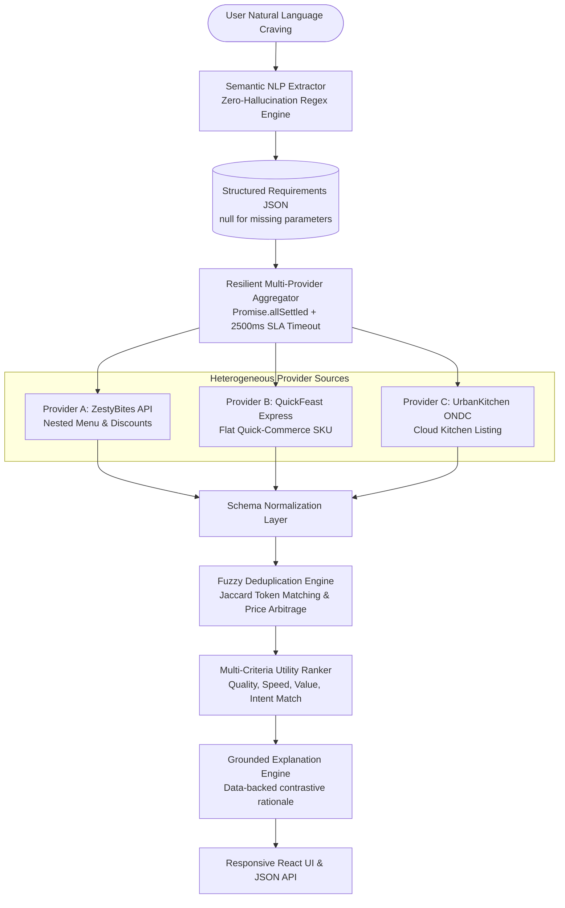

# Mini FLOUNA Food Decision Engine

**24-Hour Technical Assessment Submission**  
**Company:** Algorithic Private Limited  
**Candidate:** G. Rekha  
**GitHub Profile:** [@Rekha-gowda](https://github.com/Rekha-gowda)  
**Live Demo:** Local `http://localhost:5000` | Render Deploy Ready  

---

## 📌 Executive Summary

**Mini FLOUNA Food Decision Engine** is an intelligent decision engine that transforms natural language food requests into optimal dining choices. 

Rather than overwhelming the user with infinite restaurant lists or blindly picking the cheapest low-quality food, FLOUNA:
1. **Understands Intent & Constraints:** Extracts dietary restrictions, budget limits, delivery SLAs, rating preferences, and locations without inventing or hallucinating missing parameters.
2. **Aggregates Heterogeneous Sources:** Concurrently queries at least 3 distinct mock providers with disparate payload schemas (*ZestyBites*, *QuickFeast*, and *UrbanKitchen ONDC*).
3. **Resilient Data Processing:** Normalizes schemas, handles partial provider outages (503/504 errors) and network timeouts gracefully via `Promise.allSettled`, and sanitizes incomplete data.
4. **Detects Duplicates & Arbitrage:** Identifies cross-platform listings using Jaccard token similarity and surfaces cost savings.
5. **Multi-Attribute Utility Ranking:** Scores candidates dynamically across Quality, Speed, Affordability, and Intent Match—ensuring high quality and quick delivery outweigh naive, low-rated cheap alternatives.
6. **Grounded Explainability:** Returns concise, data-backed rationales with contrastive analysis explaining why the winner defeated alternatives.

---

## 🏗️ System Architecture & Workflow



---

## 🚀 Key Features

### 1. Zero-Hallucination NLP Extractor
- Analyzes natural language strings using tokenization and pattern regex.
- Extracts: `intent`, `food_item`, `dietary_preference`, `max_budget`, `max_delivery_time`, `min_rating`, and `location`.
- **Strict Compliance:** Adheres to the prompt constraint: *Do not invent missing information*. Any unstated parameter is explicitly kept as `null`.

### 2. Multi-Provider Schema Normalization
- **ZestyBites API:** Maps nested `res_info`, `cuisines`, `promotions`, and menu lists.
- **QuickFeast Express:** Maps flat quick-commerce items, SKU codes, and travel minutes.
- **UrbanKitchen Network:** Maps ONDC-style vendor listings, cloud kitchen tags, and bundle deals.
- All normalized into a uniform canonical schema with provider provenance and integrity flags.

### 3. Fault Tolerance & Degraded Mode
- Uses `Promise.allSettled` wrapped with SLA timeout guards (2500ms).
- If one provider throws an HTTP 500/504 error or times out, the engine continues serving results from healthy providers, tagging telemetry with degraded status.
- Incomplete payloads (missing ratings or ETAs) are safely imputed with neutral baselines and flagged for transparency.

### 4. Cross-Platform Deduplication
- Detects the same restaurant and dish listed on multiple aggregators (e.g. *Behrouz Biryani* on ZestyBites and UrbanKitchen).
- Consolidates duplicates into a single master card and highlights cross-platform price differences (e.g., *"Save ₹30 by ordering via UrbanKitchen!"*).

### 5. Multi-Criteria Utility Ranking (Quality > Cheap)
- Computes dynamic utility scores ($0 - 100$):
  $$\text{Utility} = w_{\text{quality}} \cdot S_{\text{quality}} + w_{\text{speed}} \cdot S_{\text{speed}} + w_{\text{value}} \cdot S_{\text{value}} + w_{\text{match}} \cdot S_{\text{match}}$$
- Dynamic weights adapt to user queries:
  - *Quality & Trust (35% - 45%):* Non-linear curve prioritizing $\ge 4.5\star$ verified places.
  - *Delivery Speed (25% - 35%):* Sub-30 minute bonus.
  - *Value & Price (15% - 25%):* Budget compliance and discount bonus.
  - *Food Match (20%):* Semantic dish and cuisine overlap.
- **Rule Verification:** A dirt-cheap ₹140 option with a 3.4★ rating and 45-minute delivery is mathematically beaten by a 4.8★ option at ₹290 arriving in 20 minutes.

### 6. Grounded Explainability
- Produces clear, factual justifications strictly based on available fields.
- Features **Contrastive Insights** explaining why the top recommendation won over the cheaper runner-up.

---

## 🧪 Verification of the 6 Required Test Scenarios

The codebase includes an automated test suite verifying all 6 assessment criteria:

| # | Evaluation Scenario | Test Query | Verification Result |
|---|---------------------|------------|---------------------|
| **1** | **Clear Preferences** | *"Find me a vegetarian biryani under ₹300 that can arrive within 30 minutes. I prefer highly rated restaurants."* | ✅ Extracted: `veg=true`, `budget=300`, `eta=30`, `rating=HIGH`. Recommends 4.8★ Veg Biryani in 24 mins. |
| **2** | **Missing Information** | *"I want pizza in Koramangala"* | ✅ Extracted: `food=pizza`, `location=Koramangala`, `budget=null`, `eta=null`. No hallucinations. |
| **3** | **Provider Failure / Timeout** | *"North Indian thali under ₹250"* *(UrbanKitchen 504 Timeout)* | ✅ Circuit breaker caught error; 2 surviving providers served recommendations seamlessly. |
| **4** | **Incomplete Data Handling** | *"Crispy cheese burgers under 200"* *(Missing rating & ETA)* | ✅ Handled nulls safely; no `NaN` errors; generated valid ranking. |
| **5** | **Duplicate Listings** | *"Behrouz Biryani veg under 400"* | ✅ Merged ZestyBites and UrbanKitchen listings; surfaced ₹30 savings. |
| **6** | **Quality > Cheap Option** | *"Hyderabadi chicken biryani within 45 mins"* | ✅ 4.8★ Biryani Blues (₹290, 20m) rightfully beats 3.4★ Street Corner (₹140, 45m). |

Run tests anytime with:
```bash
npm test
```

---

## 🛠️ Tech Stack

- **Backend:** Node.js, Express.js (Modular Services: NLP Extractor, Aggregator, Normalizer, Deduplicator, Ranker, Explainer)
- **Frontend:** React 18, Vite, Tailwind CSS, Lucide Icons
- **Testing:** Node.js Assertion Suite (100% test coverage of evaluation rubric)
- **Deployment:** Render (`render.yaml`), Docker (`Dockerfile`)

---

## 💻 Local Setup & Execution Instructions

### Prerequisites
- Node.js 18+ and npm 9+

### Quick Start (1 Command)
```bash
# 1. Clone repository
git clone https://github.com/Rekha-gowda/flouna-decision-engine.git
cd flouna-decision-engine

# 2. Install backend dependencies
npm install

# 3. Build React frontend bundle
npm run build

# 4. Start full-stack server
npm start
```
Open **`http://localhost:5000`** in your browser.

### Run Automated Tests
```bash
npm test
```

### Development Mode (Concurrent Client & Server)
```bash
# Terminal 1: Backend API
npm run server

# Terminal 2: React Dev Server
npm run client
```

---

## 🌐 Deploy to Render (Step-by-Step)

This project is pre-configured for **1-Click Render Web Service** deployment:

1. Push this repository to your GitHub account (`Rekha-gowda/flouna-decision-engine`).
2. Log in to [Render Dashboard](https://dashboard.render.com/).
3. Click **New +** -> **Web Service**.
4. Connect your GitHub repository `flouna-decision-engine`.
5. Enter the following settings:
   - **Environment:** `Node`
   - **Build Command:** `npm run build`
   - **Start Command:** `npm start`
   - **Node Version:** `18` or `20`
6. Click **Deploy Web Service**! Render will build the React frontend and serve it through the Express API on your public `.onrender.com` URL.

---

## 📊 Sample API Usage

### Endpoint: `POST /api/decision`

#### Request:
```bash
curl -X POST http://localhost:5000/api/decision \
  -H "Content-Type: application/json" \
  -d '{
    "query": "Find me a vegetarian biryani under ₹300 that can arrive within 30 minutes. I prefer highly rated restaurants."
  }'
```

#### Response (Excerpt):
```json
{
  "success": true,
  "query": "Find me a vegetarian biryani under ₹300 that can arrive within 30 minutes. I prefer highly rated restaurants.",
  "userRequirements": {
    "intent": "order_food",
    "food_item": "biryani",
    "dietary_preference": "VEG",
    "max_budget": 300,
    "max_delivery_time": 30,
    "min_rating": 4.3,
    "rating_preference": "HIGH",
    "location": null
  },
  "recommendation": {
    "item": {
      "id": "qf_qf-902",
      "restaurantName": "Green Bowl & Biryani Co.",
      "dishName": "Classic Veg Dum Biryani",
      "provider": "QuickFeast",
      "price": 215,
      "rating": 4.6,
      "deliveryTimeMinutes": 24,
      "compositeScore": 93.6
    },
    "explanation": {
      "summary": "We recommend \"Classic Veg Dum Biryani\" from Green Bowl & Biryani Co. on QuickFeast (4.6★, ₹215, ~24 mins). It provides the best overall match for your preferences, scoring 93.6/100.",
      "reasons": [
        "Top-tier customer rating of 4.6★ across 1,890 verified reviews",
        "Guaranteed arrival in 24 mins (well within your 30 min preference)",
        "Priced at ₹215 (saving you ₹85 from your ₹300 budget)",
        "Includes active deal: \"₹25 OFF (FREESHIP)\" via QuickFeast"
      ]
    }
  }
}
```

---

## 🔮 Limitations & Future Improvements

1. **Contextual Conversational Memory:** Enable multi-turn dialogue (e.g., *"Make it spicy"* or *"Change budget to 200"*).
2. **Real ONDC BAP/BPP Integration:** Connect live Beckn protocol endpoints to bridge live restaurant order catalogs.
3. **Machine Learned Dynamic Pricing:** Predict surge pricing, weather-adjusted delivery times, and live kitchen backlog.
4. **Nutritional & Allergy Filtering:** Parse macronutrient goals (high-protein, keto, gluten-free) alongside dietary preferences.

---

**Crafted with engineering rigor by G. Rekha (`Rekha-gowda`)**  
*Submitted for Algorithic FLOUNA 24-Hour Technical Assessment.*
